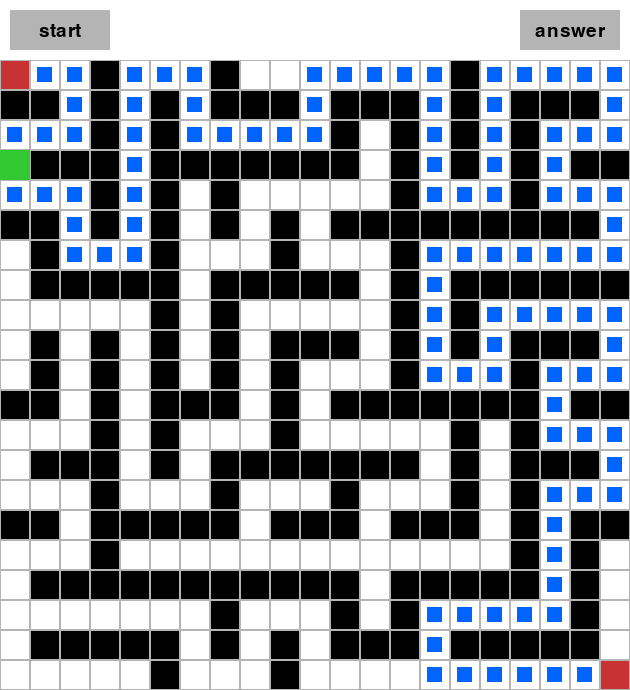
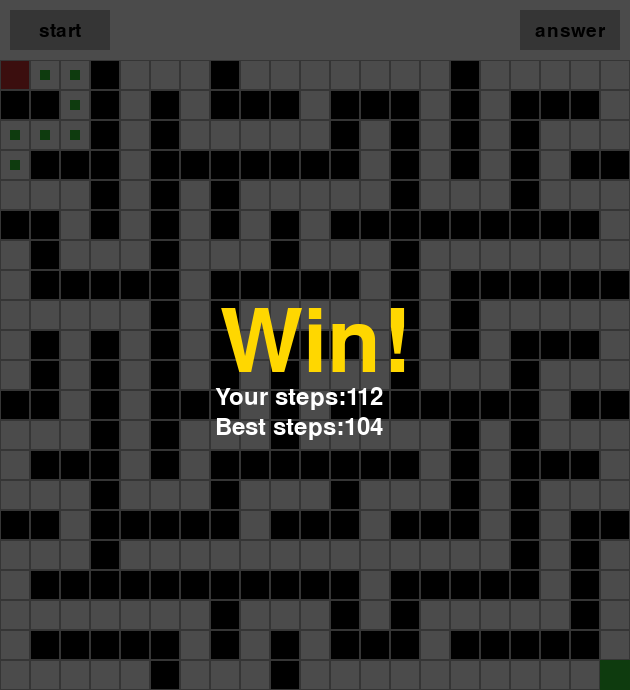

# 基于 A* 算法的迷宫寻路系统

一个使用 Python 与 Pygame 实现的交互式迷宫寻路可视化项目。程序将随机迷宫生成、玩家探索、步数统计与 A* 最优路径计算整合在同一个窗口中，适合用于理解深度优先搜索、启发式搜索以及路径可视化。



## 项目简介

本项目每次运行或点击迷宫生成按钮时，都会在 21×21 的网格上创建一座新的随机迷宫。玩家从左上角起点出发，通过键盘方向键在通道中自由探索，已走过的位置会留下绿色轨迹，并实时累计移动步数。到达右下角终点后，界面会显示 `Win!`、玩家实际步数以及由 A* 算法计算出的最佳步数。

当玩家点击 `answer` 按钮时，程序会以当前位置无关的全局最短路径为目标执行 A* 搜索，并用蓝色方块标记从起点到终点的最优解。绿色探索轨迹与蓝色推荐路线可以采用不同尺寸绘制，因此玩家能够同时观察自己的实际走法与理论最优路线。

## 功能特性

- **随机迷宫生成**：使用深度优先回溯思想在 21×21 网格中开辟通道。
- **自由探索**：使用方向键上下左右移动，墙壁会阻止非法移动。
- **轨迹与计步**：每次成功移动都会累计步数，并以绿色方块记录探索历史。
- **A* 最优路径**：基于曼哈顿距离作为启发函数，寻找四方向移动规则下的最短路径。
- **路径可视化**：按需显示蓝色最优路线，与绿色玩家轨迹形成清晰对照。
- **通关反馈**：抵达终点后显示 `Win!`、玩家步数和最佳步数。
- **即时重置**：再次点击生成按钮即可创建新迷宫并开始新一轮挑战。

## 算法实现

### 1. 深度优先回溯生成迷宫

迷宫使用二维数组表示：`1` 表示墙体，`0` 表示可通行通道。生成过程从一个已访问单元格开始，维护一个栈保存当前生成路径：

1. 从栈顶单元格出发，以两个单元格为步长随机尝试上下左右方向。
2. 若目标单元格尚未访问，则打通当前单元格与目标单元格之间的墙体。
3. 将目标单元格压入栈中，继续向更深处扩展。
4. 当当前单元格没有可扩展方向时执行回溯。

该过程不断连接尚未访问的区域，最终形成一座连通且无明显环路的随机迷宫。由于方向列表会在每次扩展前随机打乱，每次生成的拓扑结构通常不同。

### 2. 曼哈顿启发式 A* 搜索

寻路的起点为左上角 `(0, 0)`，终点为右下角 `(20, 20)`。A* 使用以下估价函数决定搜索优先级：

```text
f(n) = g(n) + h(n)
```

- `g(n)`：从起点到当前节点的已知实际代价。
- `h(n)`：当前节点到终点的曼哈顿距离，即 `|x - target_x| + |y - target_y|`。
- `f(n)`：对经过当前节点到达终点的总代价估计。

程序只考虑上下左右四个相邻通道，并将单次移动代价设为 `1`。每次从开放列表中选取 `f` 值最小的节点，更新邻居的 `g` 值及父节点关系；找到终点后，通过 `came_from` 记录逐级回溯，得到从起点到终点的完整最短路径。

在单位移动代价和四方向移动约束下，曼哈顿距离不会高估真实剩余代价，因此该启发函数满足可采纳性，可以保证搜索结果为最优路径。

## 操作说明

| 操作 | 功能 |
| --- | --- |
| 点击左上角 `start` 按钮 | 生成新的随机迷宫并重置步数与轨迹。该按钮即界面中的“创建迷宫”入口。 |
| 按 `↑` `↓` `←` `→` | 控制玩家在非墙体单元格之间移动。 |
| 点击右上角 `answer` 按钮 | 运行 A* 搜索并以蓝色方块显示最优路径。 |
| 到达右下角 | 进入通关状态，显示玩家步数和最佳步数。 |
| 通关后再按任意键 | 关闭通关遮罩，继续查看或探索迷宫。 |



## 快速开始

### 环境要求

- Python 3.10 或更高版本
- Pygame 2.6.1

### 安装与运行

```bash
python -m venv .venv
```

Windows PowerShell：

```powershell
.\.venv\Scripts\Activate.ps1
python -m pip install -r requirements.txt
python a_star_maze.py
```

macOS / Linux：

```bash
source .venv/bin/activate
python -m pip install -r requirements.txt
python a_star_maze.py
```

## 项目结构

```text
A-Star-Maze-Pathfinding-System/
├── a_star_maze.py       # Pygame 界面、迷宫生成与 A* 搜索
├── requirements.txt     # Python 依赖
└── README.md            # 项目说明
```

## 实现特点与可拓展方向

当前实现使用线性列表作为 A* 开放列表，在 21×21 的教学规模下足够直观且易于阅读。后续可以继续拓展：

- 使用优先队列优化开放列表的节点选择效率。
- 将路径搜索过程逐帧展示，观察开放列表与已访问集合的扩展顺序。
- 支持自定义迷宫尺寸、墙体编辑、障碍物权重和多目标寻路。
- 引入不同启发函数并对比搜索节点数、运行时间和路径质量。
- 增加鼠标操作、计时系统、关卡存档和算法教学面板。

## 技术栈

- Python
- Pygame
- 深度优先回溯迷宫生成
- 曼哈顿启发式 A* 路径搜索
